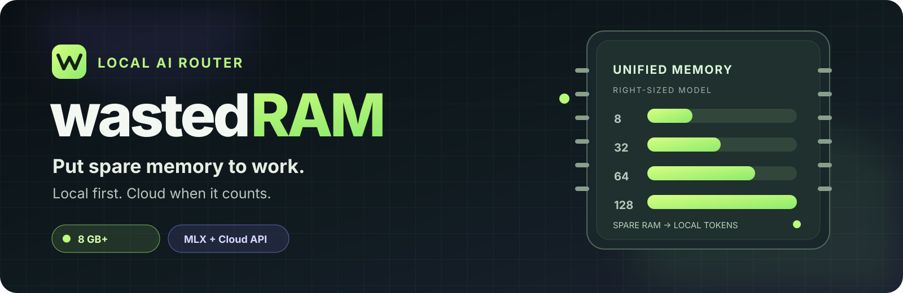

<p align="center">
  
</p>

<h1 align="center">wastedRAM</h1>

<p align="center">
  Put spare Mac memory to work on local AI tasks. Spend cloud tokens where they matter.
</p>

<p align="center">
  
  
  
  
</p>

wastedRAM is an AI coding agent skill and Python package for Apple Silicon Macs. It routes short factual and conceptual questions to a local model, and sends other tasks to an OpenAI-compatible cloud API. For larger coding tasks, its optional workflow mode lets the cloud plan and integrate work while local models handle small, independent pieces. Exact-match caching can avoid repeat calls.

Use it from a CLI, a Python agent, or a repository checkout. It works with any host that can run shell commands or Python, including Claude Code, Codex CLI, Cursor, Aider, Windsurf, and Cline.

## Quick start

You need an Apple Silicon Mac, Python 3.10+, and a cloud endpoint that serves an OpenAI-compatible `/v1/chat/completions` API. The package is not on PyPI yet; install it from Git:

```bash
pip install 'wastedram[mlx] @ git+https://github.com/igpig1226/wastedRAM.git'
```

Configure the cloud endpoint. Set a key if your provider requires one:

```bash
export WASTEDRAM_CLOUD_URL='https://api.deepseek.com/v1'
export WASTEDRAM_CLOUD_API_KEY='your-api-key'
```

Start a local MLX server in one terminal. `wastedram model` chooses a model based on your Mac's physical unified memory. The first launch downloads its weights.

```bash
mlx_lm.server --model "$(wastedram model)" --port 8080 --host 127.0.0.1
```

In another terminal, run a task:

```bash
wastedram run "Explain what a Python decorator does"
```

The answer goes to stdout. The source (`local`, `cloud`, `cloud_fallback`, or `cache`), cloud token count, and elapsed time go to stderr. The CLI still requires `WASTEDRAM_CLOUD_URL` for local-only requests because it initializes the router before choosing a route; a cloud key is optional for endpoints that do not require one.

## How it works

| Request | Default behavior |
| --- | --- |
| Short, low-risk factual or translation question | Local MLX model, with a small response budget |
| Self-contained conceptual question | Local MLX model, with a larger response budget |
| Coding or other request outside those categories | Cloud model |
| Repeated request with the same endpoints and models | Cached answer, when caching is enabled |

If a local call fails or is truncated, wastedRAM falls back to the cloud. Route mode uses conservative text heuristics; it does not guarantee that every easy request stays local. Use `--mode workflow` to ask the cloud to plan a larger task, run up to two independent local pieces in parallel, and synthesize the answer in the cloud:

```bash
wastedram run "Design a parser and include tests" --mode workflow
```

Workflow mode currently handles text tasks. Its built-in code checks cover specific patterns, not general correctness. Review generated code before using it. Actual token savings depend on your task mix, cache hits, and provider pricing; `cloud_tokens` reports usage for a run, not a measured cost comparison.

## Use it with an agent

The skill entry point is [`wastedram/SKILL.md`](wastedram/SKILL.md). Put the `wastedram/` directory in your agent's skill directory, or point the agent at this repository. Keep its `scripts/` and `references/` folders with it. The skill describes when to invoke wastedRAM and how to choose a model.

You can also call the package directly from an agent or your own Python code:

```python
from wastedram.skill_entry import run

result = run(
    task="Implement a Python parse_port(value) function with tests",
    cloud_url="https://api.deepseek.com/v1",
    cloud_model="deepseek-chat",
    cloud_key="your-api-key",
    local_model="mlx-community/Qwen2.5-Coder-7B-Instruct-8bit",
)
print(result["content"])
print(result["source"], result["cloud_tokens"])
```

The Python entry point selects workflow mode for an explicit workflow request or a long coding request; the CLI stays in route mode unless you pass `--mode workflow`. Pass the same local model ID that your server loaded.

For an agent that can access this checkout but cannot install the package, use the repository script:

```bash
python wastedram/scripts/run_task.py "Explain this function" \
  --cloud-url https://api.deepseek.com/v1 \
  --cloud-key your-api-key \
  --local-model "$(PYTHONPATH=src python -m wastedram.cli model)"
```

The checkout script adds `src/` to Python's import path. It still needs the package's `requests` dependency and a running local server for local inference.

## Pick a local model

`wastedram model` uses these conservative defaults. The listed sizes are approximate model weights, **not total runtime memory**. Context, MLX, macOS, and other apps need space too.

| Unified memory | Recommended model | Weights, approx. |
| --- | --- | ---: |
| Up to 16 GB | [`Qwen2.5-Coder-7B-Instruct-4bit`](https://huggingface.co/mlx-community/Qwen2.5-Coder-7B-Instruct-4bit) | 4.0 GiB |
| 17-32 GB | [`Qwen2.5-Coder-7B-Instruct-8bit`](https://huggingface.co/mlx-community/Qwen2.5-Coder-7B-Instruct-8bit) | 7.5 GiB |
| 33-48 GB | [`Qwen2.5-Coder-14B-Instruct-8bit`](https://huggingface.co/mlx-community/Qwen2.5-Coder-14B-Instruct-8bit) | 14.6 GiB |
| 49-64 GB | [`Qwen2.5-Coder-32B-Instruct-4bit`](https://huggingface.co/mlx-community/Qwen2.5-Coder-32B-Instruct-4bit) | 17.2 GiB |
| 65-127 GB | [`Qwen2.5-72B-Instruct-4bit`](https://huggingface.co/mlx-community/Qwen2.5-72B-Instruct-4bit) | 38.1 GiB |
| 128 GB or more | [`Qwen2.5-72B-Instruct-8bit`](https://huggingface.co/mlx-community/Qwen2.5-72B-Instruct-8bit) | 71.9 GiB |

The 72B tiers are general Instruct models. A larger tier is not automatically better for your task. If your Mac swaps or slows down, choose a smaller model or shorter context. To override the recommendation, start the server with your chosen model and pass the same ID to `wastedram run --local-model`.

## Configuration

| Setting | Purpose |
| --- | --- |
| `WASTEDRAM_CLOUD_URL` | OpenAI-compatible cloud `/v1` URL; required by the CLI |
| `WASTEDRAM_CLOUD_API_KEY` | Cloud key, when the provider requires one |
| `WASTEDRAM_LOCAL_URL` | Local server URL; defaults to `http://127.0.0.1:8080` |
| `--cloud-model` | Cloud model for this run; defaults to `deepseek-chat` |
| `--local-model` | Override the memory-based local model selection |
| `--no-cache` | Skip response cache lookup and storage for this run |

`PIGMODEL_CLOUD_URL`, `PIGMODEL_CLOUD_API_KEY`, and `PIGMODEL_LOCAL_URL` remain compatible aliases; the `WASTEDRAM_*` names take precedence. See [`.env.example`](.env.example). The CLI does **not** load `.env` automatically: export values in your shell and keep keys out of Git.

Using Ollama? Point wastedRAM at its OpenAI-compatible API and provide an installed model ID:

```bash
WASTEDRAM_LOCAL_URL=http://127.0.0.1:11434 \
  wastedram run "Explain this function" --local-model qwen2.5-coder:7b
```

## Repository layout

```text
wastedram/                 Agent skill, checkout script, and reference guides
src/wastedram/             Router, workflow, CLI, and code checks
scripts/start_local.sh     Helper to launch the local MLX server
assets/                    README artwork
```

See the [model guide](wastedram/references/models.md) for memory advice and the [troubleshooting guide](wastedram/references/troubleshooting.md) for common errors. The routing engine is also developed in the [pigmodel repository](https://github.com/igpig1226/pigmodel); you do not need it to use wastedRAM.

## License

[MIT](LICENSE)
